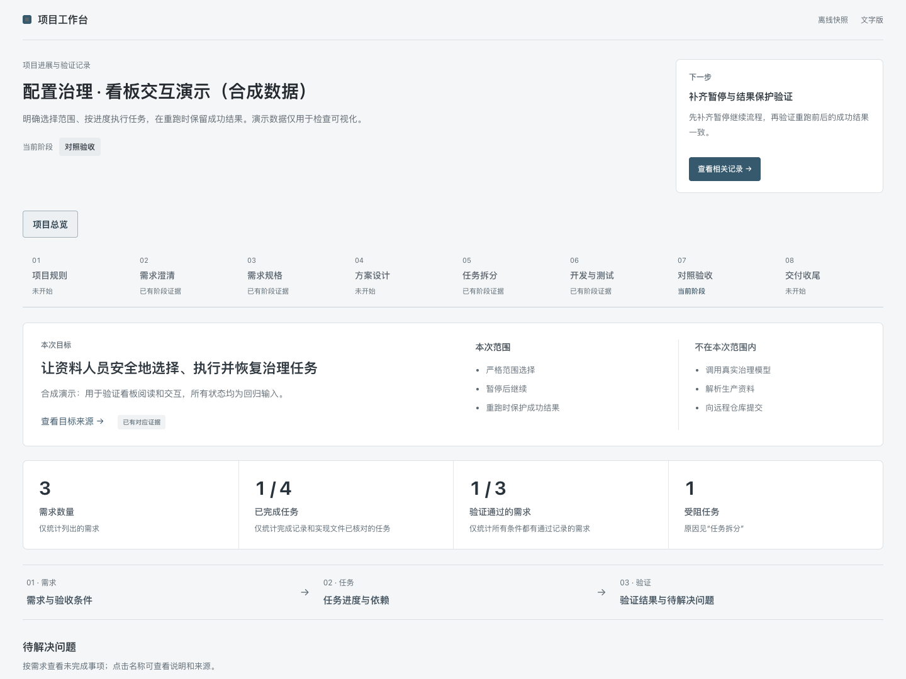

# SDD Workbench

**让 AI 编程任务的需求、设计、实现和验证有据可查。**

[](https://github.com/Fovercon/sdd-workbench/actions/workflows/ci.yml)
[](https://github.com/Fovercon/sdd-workbench/releases/latest)
[](CONTRIBUTING.md)
[](THIRD_PARTY_NOTICES.md)

面向研发工程师的规格驱动工程技能套件。12 个 skills 共用一套内容，提供 Codex、Hermes、Z.ai ZCode、DeepSeek Harness、OpenCode 和 Pi 的安装入口。代理按任务加载所需技能，小改动可直接处理，复杂任务保留需求、设计、实现、验证与交付之间的对应关系。

Specification-driven engineering skills for coding agents, with traceable work, an offline project board, and guarded installation and recovery. See [compatibility](docs/AGENT-COMPATIBILITY.md) for what has actually been tested.

[快速开始](docs/QUICKSTART.md) · [安装](#安装) · [项目看板](#项目看板) · [维护指南](docs/OPERATIONS.md) · [参与维护](CONTRIBUTING.md) · [安全与构建验证](SECURITY.md)

## 能解决什么

| 实际问题 | 提供的机制 |
|---|---|
| 聊天里的需求变了，实现和旧测试还在沿用 | 明确需求与验收条件，追踪变更影响；保留旧证据并标记来源变化 |
| 只看到“完成”或一串文档，难以判断做到哪一步 | 看板串起需求、任务、实现文件与验证记录，分别显示未完成、未执行和失败 |
| 换代理、换会话或升级安装时丢上下文、覆盖本地修改 | 使用有来源的交接记录；Python安装器保护用户编辑、备份与中断恢复 |

这些是已实现的工程机制。尚无同条件框架对比或真人试用数据支持效率排名；安装/发现支持也不等于六个平台均已完成业务验证。验证范围见 [平台说明](docs/AGENT-COMPATIBILITY.md)，后续工作见 [优化记录](https://github.com/Fovercon/sdd-workbench/blob/v0.4.0/docs/optimization/V0.4.0-PLAN.md)。

## 从一个任务开始

安装后，在当前项目对话中直接说明目标：

- **修复问题**：“用 SDD Workbench 修复这个问题：〈现象〉。正确行为依据是〈来源〉。实际完成修复与回归，保留其他修改。”
- **开发功能**：“把〈使用者与目标〉整理为可评审的需求，再做设计和任务拆分。已知约束是〈内容〉。”
- **了解进展**：“只报告当前进展和下一步，不修改文件。”
- **查看项目**：“生成中文项目看板，展示需求、任务、实现文件和验证记录。”

你保留的审批、实际业务含义和宿主权限仍然有效。安装整套不要求一次加载全部技能；完整示例和卡住时的处理见 [第一次使用](docs/QUICKSTART.md)。

## 项目看板

先看目标和范围，再沿“需求 → 任务 → 实现文件 → 验证”检查具体进展。
项目规则、需求澄清、开发与测试、交付收尾采用统一层次；缺少资料显示“未记录”，测试结果和交付事实均可查看原始来源。



上图为独立合成样例。看板从你自己的项目材料生成，不附带业务数据；支持离线设计图、桌面与窄屏阅读。静态HTML可以阅读，保存反馈需启动仅绑定本机回环地址的服务。

[生成与更新](skills/sdd-workflow-router/references/project-view.md) · [需求到验收](skills/sdd-workflow-router/references/project-view-mainline.md) · [四阶段内容](skills/sdd-workflow-router/references/project-view-stage-details.md) · [本机反馈](skills/sdd-workflow-router/references/human-decisions.md)

## 安装

### 六平台代理共用一套 skills

推荐在终端执行这一行（需要 Node.js 20+ 和 Git）：

```sh
npx skills@1.7.4 add https://github.com/Fovercon/sdd-workbench/tree/v0.4.0 -g -a codex hermes-agent zcode opencode pi -y
```

此命令使用 [Vercel Skills CLI](https://github.com/vercel-labs/skills)，将全部 12 个 skills
及资源放在 `~/.agents/skills`。Codex、OpenCode、Pi 和 DeepSeek Harness
0.2.1-rc.2 的文件系统 provider 可直接发现此目录；Hermes、ZCode 通过链接使用同一份内容。
DeepSeek 尚无该 CLI 的 agent ID，因此命令没有虚构 `--agent deepseek`。
Windows 创建链接受系统权限影响时，CLI 可能回退为复制；可改用下面的 Python 安装。

只给某个平台安装，或使用平台原生插件入口：

| 平台 | 一行安装命令 |
|---|---|
| Codex | `npx skills@1.7.4 add https://github.com/Fovercon/sdd-workbench/tree/v0.4.0 -g -a codex -y` |
| Hermes | `npx skills@1.7.4 add https://github.com/Fovercon/sdd-workbench/tree/v0.4.0 -g -a hermes-agent -y` |
| Z.ai ZCode | `npx skills@1.7.4 add https://github.com/Fovercon/sdd-workbench/tree/v0.4.0 -g -a zcode -y` |
| DeepSeek Harness | `dsh plugin --profile cli add 'github:Fovercon/sdd-workbench#v0.4.0'` |
| OpenCode | `npx skills@1.7.4 add https://github.com/Fovercon/sdd-workbench/tree/v0.4.0 -g -a opencode -y` |
| Pi Agent | `pi install git:github.com/Fovercon/sdd-workbench@v0.4.0` |

原生插件仍读取仓库中的同一个 `skills/`，不维护平台专用指令副本。DeepSeek 命令中的
`cli` 是 profile 名，可换成实际使用的 profile；需要 Harness 0.2.1-rc.2。
如已通过共享目录安装，无需再装同一套原生插件。安装后重启客户端或重新加载 skills。
路径、版本和实测边界见 [平台兼容与验证](docs/AGENT-COMPATIBILITY.md)。

### 原生插件源

支持插件命令的 Codex 客户端也可执行：

```sh
codex plugin marketplace add Fovercon/sdd-workbench --ref v0.4.0 && codex plugin add sdd-workbench@sdd-workbench
```

ZCode 可在 Settings → Plugins → Create marketplace 中填写
`https://github.com/Fovercon/sdd-workbench`，然后安装 SDD Workbench。
仓库提供 `.codex-plugin/`、`.agents/plugins/`、`.zcode-plugin/`、根 marketplace、Pi package
和 DeepSeek bundle 元数据。ZCode 官方入口为界面操作，终端一行安装使用上面的 Skills CLI。

### Python 整套安装

需要 Python 3.10+ 和 Git；安装器无第三方依赖，支持 macOS、Linux、Windows：

```sh
git clone --branch v0.4.0 --depth 1 https://github.com/Fovercon/sdd-workbench.git
cd sdd-workbench
python3 tools/install.py install --agent all
```

`all` 为六个平台各安装一份受回执管理的完整副本；若希望只有一个公共目录，使用
`--agent shared`，并按兼容说明配置 Hermes、ZCode 的入口。也可以下载
[Release ZIP](https://github.com/Fovercon/sdd-workbench/releases/tag/v0.4.0)，解压后运行安装器。
Windows 可将 `python3` 替换为 `python`。

可指定 `--agent codex hermes zcode deepseek opencode pi` 中的一个或多个。
不传 `--agent` 保留旧行为：安装到 `$CODEX_HOME/skills` 或 `~/.codex/skills`。
`--dest /path/to/skills` 和 `--state /path/to/state` 只接受单目标。
`--home /temporary/base` 可指定隔离基目录，并忽略平台环境变量，适合测试。

安装器会保护无关 skills 和用户编辑。旧的同名内容不同时停止；显式使用 `--adopt`
可先备份再迁移。回执和备份位于各目标旁的 `.sdd-workbench/`，请保留。
同一目录选择一种安装管理方式；Vercel CLI 与原生插件不使用 Python 的回执和备份。

v0.3.0 起提供写入前预览：`python3 -B tools/install.py install --agent all --dry-run`。
它列出逐技能差异与阻塞，不创建锁或备份；已发布 v0.2.1 的工具尚无此参数。
更新、回退、中断恢复和维护者交接的完整路径见[安装维护指南](docs/OPERATIONS.md)。
需要多名 agents/专家跨版本审查时，可用 v0.3.0 新增的[反馈校验工具](docs/REVIEW-FEEDBACK.md)
固定来源、关联复验并保留争议；普通任务无需额外填写报告。

## 更新与故障处理

Python安装用户从目标版本运行 `install`，先用 `--dry-run` 查看变化；用户编辑会阻止覆盖，显式覆盖仍保留备份。
`rollback` 回退最近一次操作，`recover` 恢复中断事务，`tools/doctor.py --agent all` 只读检查安装状态。
使用与安装时相同的目标参数；其他管理方式遵循各自的更新入口。

具体命令、跨版本注意事项及交接步骤见 [安装维护指南](docs/OPERATIONS.md) 和 [诊断说明](docs/DOCTOR.md)。

## 套件内容

| Skill | 作用 |
|---|---|
| `sdd-project-bootstrap` | 建立或检查项目规则、真源与开发基线 |
| `sdd-workflow-router` | 判断当前阶段、推进已授权任务、生成看板 |
| `sdd-requirements-contract` | 整理需求、澄清意图与验收条件 |
| `sdd-plan-slices` | 技术设计、设计图、任务切片与执行卡 |
| `sdd-implement-slice` | 实现并验证一个已批准的功能切片 |
| `sdd-converge-review` | 对照规格、设计和实现判断是否收敛 |
| `sdd-finish-readiness` | 检查具体交付、集成或发布动作是否就绪 |
| `sdd-verification-design` | 设计与风险对应的验证证据 |
| `sdd-change-impact` | 识别变更归属和下游影响 |
| `sdd-code-review` | 对无规格基线的代码进行工程评审 |
| `sdd-context-handoff` | 跨会话、代理或工具交接上下文 |
| `sdd-retrospective` | 从实际工作中提炼方法改进 |

详细边界见 [能力目录](skills/CATALOG.md)，方法维护规则见
[套件政策](skills/SUITE-POLICY.md)。

## 维护与信任

- [贡献说明](CONTRIBUTING.md)：复现输入、回归、真实浏览器和方法评测要求。
- [安全说明](SECURITY.md)：私密报告入口、发行包校验和构建来源证明。
- [发布流程](docs/RELEASING.md)：唯一版本真源、完整CI、不可变标签与资产。
- [证据与验证边界](docs/VALIDATION.md)：区分结构测试、模型演练、历史报告与实际使用。

**许可证待定。** 当前未选择项目级开源许可证；构建证明不授予使用或再分发许可。Mermaid 的独立许可及来源见 [第三方声明](THIRD_PARTY_NOTICES.md)；套件原始来源见 [UPSTREAM.json](docs/UPSTREAM.json)。
